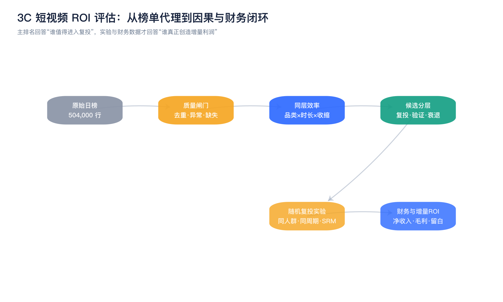
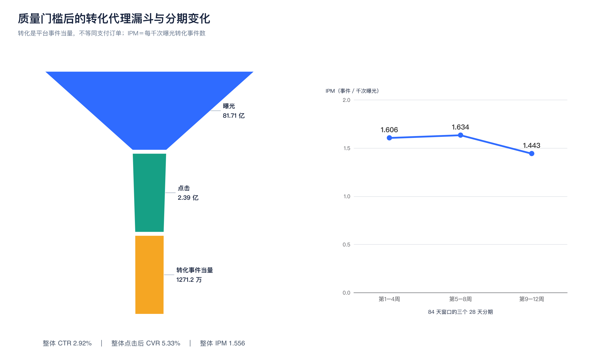
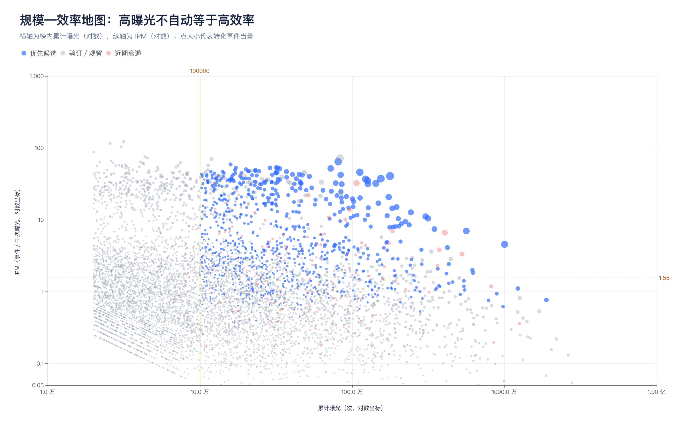
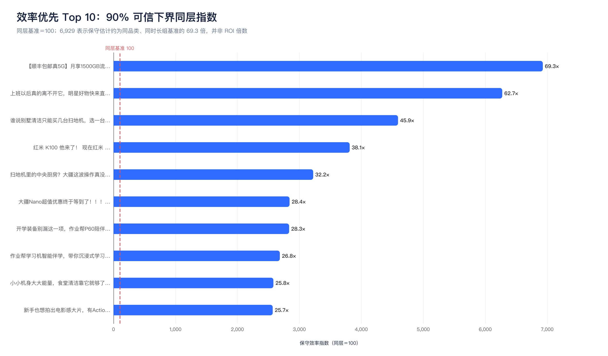
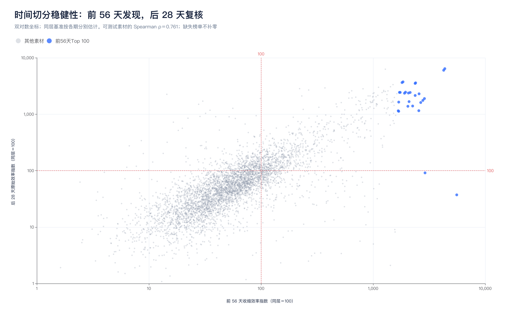

# 3C 短视频 ROI 评估与高潜视频筛选报告

**数据窗口：2026-08-11—2026-11-02｜调研与计算日期：2026-11-10｜行业：巨量云图行业 17（3C 数码外设）**

## 执行摘要

这次分析完成了两项工作：一是把 84 天、576,000 条原始记录清洗为 504,000 条“日期—素材”唯一记录，覆盖 59,232 条素材；二是建立了一套可以复算的“质量闸门—同层比较—贝叶斯收缩—时间复核—实验与财务升级”评估体系。必须首先明确：**原始数据没有媒体消耗、支付 GMV、退款、毛利和素材成本，因此本报告不能直接给出真实财务 ROI，也不能证明增量 ROI。** 当前榜单回答的是“哪些视频的转化效率代理更值得进入复投测试”，其中转化数是依据平台字段重建的**转化事件当量**，不是已核验的支付订单。

在通过质量门槛后，数据包含 **8,170,997,693 次曝光、238,705,549 次点击和 12,711,772 次转化事件当量**，整体 CTR 为 **2.92%**、点击后 CVR 为 **5.33%**、IPM（每千次曝光转化事件当量）为 **1.556**。最终有 **846 条**素材进入“规模证据充分、近 28 天仍有足量证据、同层效率高且未明显衰退”的优先池，另有 **3,027 条**进入复测池、**794 条**进入效率衰退观察池。效率榜首为“顺丰包邮真 5G 随身 WiFi”素材，IPM 为 **46.72**，保守同层指数为 **6,929**；规模榜首为“馒头乐园键盘”素材，累计转化事件当量为 **57,383**；大疆 Action 4 素材则兼具 **809,075 次曝光、51,742 次转化事件当量、63.95 的 IPM 和近 28 天仅 −0.3% 的效率变化**，是较均衡的优先复核对象。

**建议的使用方式不是直接给榜首加满预算，而是：先核对平台“转化”的业务定义，再从效率榜、规模榜和品类代表中选 10–20 条做同人群、同周期、同报价的随机复投；用消耗、净支付、退款和贡献毛利计算财务 ROI，最后以留白实验或 MMM 验证增量。** 这样既能利用 59,232 条素材的行业信息，又能避免小样本高 CVR、榜单幸存者偏差和平台归因造成的“虚假冠军”。



---

## 一、数据审计与结论边界

### 1.1 原始数据、去重与重建结果

原始说明将数据定义为巨量云图行业 17 的曝光降序日榜，时间窗为 2026-08-11 至 2026-11-02，共 84 天；主文件与补抓文件合计 576,000 行，其中 72,000 行为重复记录。[00_说明](kimi-cite://md-line?path=%2FUsers%2Flinan%2FDesktop%2F%E6%8A%95%E6%94%BE%E8%A7%86%E9%A2%91%E5%8E%9F%E5%A7%8B%E6%95%B0%E6%8D%AE%2F00_%E8%AF%B4%E6%98%8E.md&line=7&text=%E6%97%B6%E9%97%B4%E7%AA%97%EF%BC%9A2026-08-11%20~%202026-11-02%EF%BC%8C%E5%85%B1%2084%20%E5%A4%A9 "citation") 本次严格按 `material_uri` 做同日去重并保留最大曝光记录，跨天才进行求和；这一处理与原始说明的去重规则一致。[00_说明](kimi-cite://md-line?path=%2FUsers%2Flinan%2FDesktop%2F%E6%8A%95%E6%94%BE%E8%A7%86%E9%A2%91%E5%8E%9F%E5%A7%8B%E6%95%B0%E6%8D%AE%2F00_%E8%AF%B4%E6%98%8E.md&line=32&text=%E5%90%8C%E4%B8%80%E5%A4%A9%E5%8F%96%E6%9C%80%E5%A4%A7%E6%9B%9D%E5%85%89%EF%BC%8C%E4%B8%8D%E7%B4%AF%E5%8A%A0 "citation")

榜单每天只保留前 6,000 名，未出现意味着“缺失”，而不是“曝光为零”。因此，本报告没有把缺失日期补零，也没有把后期未进榜直接解释为素材死亡。[00_说明](kimi-cite://md-line?path=%2FUsers%2Flinan%2FDesktop%2F%E6%8A%95%E6%94%BE%E8%A7%86%E9%A2%91%E5%8E%9F%E5%A7%8B%E6%95%B0%E6%8D%AE%2F00_%E8%AF%B4%E6%98%8E.md&line=96&text=%E8%BF%99%E6%98%AF%E3%80%8C%E7%BC%BA%E5%A4%B1%E3%80%8D%E4%B8%8D%E6%98%AF%E3%80%8C%E6%9B%9D%E5%85%89%E4%B8%BA%200%E3%80%8D%EF%BC%8C%E4%B8%8D%E8%A6%81%E8%A1%A5%200 "citation") 独立校验确认：84 天每天均为 6,000 条，日期—素材键无重复，59,232 条素材均只保留一条视频级汇总记录。

| 数据处理项目 | 结果 | 对评估的影响 |
|---|---:|---|
| 主文件原始行 | 240,000 | 66 天仅有前 2,000 名，必须与补抓文件合并 |
| 补抓文件原始行 | 336,000 | 补齐每日第 3–6 页 |
| 同日重复剔除 | 72,000 | 不累加重复曝光，避免虚增规模 |
| 清洗后日行 | **504,000** | 84 天 × 6,000，结构完整 |
| 不同素材 | **59,232** | 以 `material_uri` 为跨天主键 |
| 漏斗异常排除 | **102 行，0.020%** | CVR 超界、转化大于点击或恒等式不成立 |
| 留存联合校验异常 | **41,341 行，8.20%** | 不参与联合留存诊断，不影响转化主排名 |
| 明显非 3C 素材 | **6,504 条** | 洗护等明显跨行业记录从候选池排除 |

### 1.2 为什么当前不能称为“真实 ROI 排名”

财务 ROI 至少需要消耗和回报两端，而当前数据只有内容表现字段。平台中的 `cvr` 也没有附带可机读的业务事件定义，无法确认它对应商品点击、预约、下单、支付还是其他转化；少数原始记录甚至出现 CVR 大于 100%，说明不能不加检查地把字段当作订单转化率。虽然这些异常日记录已被排除，但保留记录中仍有部分素材呈现很高的平台 CVR，因此**在预算动作之前，必须在云图后台核对转化事件、归因窗口、去重方式和自然／广告流量口径**。

本报告把 `pvr` 解释为曝光级转化代理，是因为在几乎全部原始行中存在 `pvr = ctr × cvr` 的数值关系；曝光乘 `pvr` 可以重建整数事件当量。这个勾稽关系可以验证计算结构，却不能验证业务含义，更不能替代支付订单和财务收入。由此形成的榜单是**高转化效率代理候选榜**，不是财务审计结果，也不是“投放后一定会盈利”的承诺。

| 当前可以回答               | 当前不能回答                    |     |
| ---                  | ---                       | --- |
| 哪些素材在同品类、同时长组中转化效率较高 | 哪条素材的真实 ROAS 或净利润最高       |     |
| 哪些素材具有足够曝光、点击和事件样本   | 转化事件是否等于支付订单              |     |
| 哪些素材在后期仍有表现或出现衰退     | 衰退是否由频次、出价、报价或竞争造成        |     |
| 哪些素材值得进入随机复投         | 广告带来的增量订单与增量利润            |     |
| 哪些漏斗环节需要优先诊断         | 每条素材的真实 CPM、CPA、AOV 与 LTV |     |

---

## 二、外部调研如何转化为评估原则

### 2.1 GitHub 最新实践：从归因分数升级为测量系统

GitHub 调研的重点不是寻找一个“自动算出爆款”的仓库，而是提取成熟项目对不确定性、饱和、因果和实验的工程处理。Meta Robyn 当前仍强调 Ridge、时间序列分解、adstock、饱和曲线和预算分配，说明 ROI 建模需要处理滞后与边际递减，而不是静态比较一次 ROAS。[Meta Robyn](kimi-cite://web?url=https%3A%2F%2Fgithub.com%2Ffacebookexperimental%2FRobyn "citation") Google Meridian 的 2026 年文档则明确使用贝叶斯因果推断、地理级数据、实验校准和 ROI 不确定性，为本报告的“点估计＋区间＋证据分层”提供了直接方法参照。[Google Meridian](kimi-cite://web?url=https%3A%2F%2Fgithub.com%2Fgoogle%2Fmeridian "citation")

PyMC-Marketing 已把 MMM、CLV、因果识别、漏斗中介、提升实验和预算优化放入同一工具链；GrowthBook 的当前实现包含 CUPED、序贯检验、贝叶斯分析、后分层、Bandits 和 SRM 检查。[PyMC-Marketing](kimi-cite://web?url=https%3A%2F%2Fgithub.com%2Fpymc-labs%2Fpymc-marketing "citation") [GrowthBook](kimi-cite://web?url=https%3A%2F%2Fgithub.com%2Fgrowthbook%2Fgrowthbook "citation") 因此，本体系不把历史行业榜单强行包装成因果模型，而是把它放在最上游做候选发现，把随机实验和财务数据放在确认层。

| 开源实践 | 可借鉴机制 | 本体系中的具体落地 |
|---|---|---|
| Meta Robyn | adstock、饱和、趋势与季节性 | 后期增加频次、边际 ROI 和预算饱和分析 |
| Google Meridian | 贝叶斯因果、实验先验、地理数据 | 报告区间；用留白实验校准 MMM，而非只报点估计 |
| PyMC-Marketing | 漏斗中介、CLV、因果识别、实验校准 | 区分观看、点击、转化、利润和长期价值 |
| EconML | 异质处理效应与区间 | 后续估计不同人群、品类和报价下的增量差异。[EconML](kimi-cite://web?url=https%3A%2F%2Fgithub.com%2Fpy-why%2FEconML "citation") |
| Vowpal Wabbit | 上下文 Bandit 与在线学习 | 有随机分配概率后，再动态分配探索与利用预算。[Vowpal Wabbit](kimi-cite://web?url=https%3A%2F%2Fgithub.com%2FVowpalWabbit%2Fvowpal_wabbit "citation") |
| GrowthBook | CUPED、SRM、序贯与贝叶斯实验 | 复投实验加入分配校验、方差缩减和停止规则 |
| JD-GenX CAIG | 多模态特征与点击偏好奖励模型 | 素材标签可做分层和预测特征，但 CTR 目标不能替代利润。[JD-GenX CAIG](kimi-cite://web?url=https%3A%2F%2Fgithub.com%2FJD-GenX%2FCAIG "citation") |

### 2.2 X 与短视频行业实践：创意漏斗、利润和多样性

X 原帖提供了有价值的一线反例。Obvi 联合创始人 Ash Melwani 分享的测试中，转化率约提高 10%、订阅占比约 40%，但 AOV 下降 23%、每次访问利润下降 12%；这说明“CVR 上升”并不自动意味着商业胜利。[Ash Melwani，X](kimi-cite://web?url=https%3A%2F%2Fx.com%2FAshvinMelwani&text=Conversion%20Rate%20increased%20by%2010%25 "citation") Fraser Cottrell 近期展示了 AI 角色吸引注意、真实 UGC 承接的混剪形式，适合作为素材变体假设，而不是未测试就复制的爆款公式。[Fraser Cottrell，X](kimi-cite://web?url=https%3A%2F%2Fx.com%2FSourFraser&text=It%27s%20AI%20and%20real%20footage%20mixed "citation")

Andrew Foxwell 在 2026 年 11 月的帖子中强调，对失败率的恐惧会损害创意多样性，团队之间比拼命中率也会伤害团队。[Andrew Foxwell，X](kimi-cite://web?url=https%3A%2F%2Fx.com%2Fandrewfoxwell&text=why%20fear%20kills%20creative%20diversity "citation") 这与组合式素材管理一致：保留探索预算、测试不同开场与论证路径，比只复制历史冠军更可持续。X 帖子在这里被视为实践观点和待验证假设，不作为普遍提升百分比的证据。

TikTok 官方指南建议前 3 秒交代内容主张、前 6 秒强化钩子，采用“钩子—独特卖点—明确 CTA”，并在每个广告组测试 3–5 个差异明显的素材。[TikTok for Business](kimi-cite://web?url=https%3A%2F%2Fads.tiktok.com%2Fhelp%2Farticle%2Fcreative-best-practices&text=Prioritize%20your%20hook%20in%20the%20first%206%20seconds "citation") 巨量官方资料也支持用“转化×曝光”矩阵和场景、卖点、痛点、人物、人群标签做创意洞察。[巨量引擎](kimi-cite://web?url=https%3A%2F%2Fwww.oceanengine.com%2Fblog%2F818-zhibojian-gonglue.html "citation") 本报告因此保留效率与规模两个榜单，并把 3 秒、5 秒、完播、互动、人群和素材标签作为诊断维度，而非全部压进一个不透明总分。

### 2.3 营销学博士课程理论：每个指标都有理论角色

精细加工可能性模型（ELM）指出，产品涉入会改变中央论证与外围线索的作用。对高客单、参数复杂、兼容性重要的 3C 产品，消费者可能更需要规格证据、实测、兼容性和售后保证，而不是只有明星、猎奇或情绪钩子。[Petty 等，Journal of Consumer Research，1983](kimi-cite://web?url=https%3A%2F%2Facademic.oup.com%2Fjcr%2Farticle-abstract%2F10%2F2%2F135%2F1801204&text=Central%20and%20peripheral%20routes%20to%20advertising%20effectiveness "citation") 短视频实证研究也发现，可信度、专业性和吸引力与购买行为相关，但真实性和品牌传统可能呈非线性关系，所以内容标签不应被简单设为“越多越好”。[Meng 等，Journal of Business Research，2024](kimi-cite://web?url=https%3A%2F%2Fwww.sciencedirect.com%2Fscience%2Farticle%2Fpii%2FS0148296324003783&text=trustworthiness%2C%20expertise%2C%20and%20attractiveness%20positively%20impact%20consumer%20purchase "citation")

广告重复研究支持 wear-in／wear-out 及品牌熟悉度差异，意味着素材疲劳应看自身历史趋势和重复触达，而不是按上线天数统一淘汰。[Campbell 与 Keller，Journal of Consumer Research，2003](kimi-cite://web?url=https%3A%2F%2Facademic.oup.com%2Fjcr%2Farticle-abstract%2F30%2F2%2F292%2F1831686&text=Brand%20familiarity%20and%20advertising%20repetition%20effects "citation") 大型广告实验还表明，观察性归因和随机实验可能给出不同答案，且销售结果的噪声会使低功效实验难以识别经济上有意义的效应。[Gordon 等，Marketing Science，2019](kimi-cite://web?url=https%3A%2F%2Fpubsonline.informs.org%2Fdoi%2Fabs%2F10.1287%2Fmksc.2018.1135 "citation") [Johnson 等，Marketing Science，2017](kimi-cite://web?url=https%3A%2F%2Fpubsonline.informs.org%2Fdoi%2Fabs%2F10.1287%2Fmksc.2016.0998 "citation")

| 理论或方法 | 对筛选维度的要求 | 防止的错误 |
|---|---|---|
| ELM 与产品涉入 | 高涉入 3C 增加功能证据、实测、兼容性、售后和人群匹配 | 用猎奇开场替代说服，误把停留当购买 |
| 漏斗与条件概率 | 分别观察曝光→点击→事件，主指标使用 `CTR×CVR` | 高 CTR 掩盖低 CVR，或高 CVR 掩盖没有流量 |
| 内容价值与来源可信度 | 标签用于同类比较和创意假设 | 把 AI 审美分当作转化证据 |
| wear-in／wear-out 与 adstock | 比较素材自身历史、近期变化和后续饱和 | 机械按素材年龄淘汰，忽略滞后效应 |
| 因果推断与增量 | 用随机留白、地域实验或 MMM 验证增量 | 把平台归因订单当成广告新增订单 |
| 行为经济与单位经济 | 最终看 AOV、贡献毛利、退款、LTV 和回收期 | CVR 上升但利润下降 |
| 多重比较与赢家诅咒 | 收缩、下界、时间验证、必要时 FDR | 从 59,232 条中挑出偶然最高的一次结果 |

---

## 三、可执行的评估体系

### 3.1 第一层：质量闸门与统一口径

质量闸门先于任何排名。点击和转化事件当量按下列公式重建，并在日级完成异常检查后再汇总；同一天同素材只保留最大曝光行，未进榜日期保持缺失。`round` 表示还原到最近的整数事件数，99% 的重建残差仅约 `10^-11`，最大残差为四舍五入产生的 0.5。

```text
Clicks_hat = round(Impressions × CTR)
Events_hat = round(Impressions × PVR)
IPM        = 1,000 × ΣEvents_hat / ΣImpressions
CTR_w      = ΣClicks_hat / ΣImpressions
CVR_w      = ΣEvents_hat / ΣClicks_hat
```

进入主评分的日记录必须满足：曝光大于零；CTR、CVR、PVR 均在 `[0,1]`；事件当量不大于点击；`|CTR×CVR−PVR| ≤ 10^-6`。留存字段另行检查，因为 41,324 条记录出现完播率大于 5 秒率，说明在缺少平台进一步口径说明时，不能强行把它们当成同一批用户的严格嵌套漏斗。**主排名不使用点赞、评论或完播来“加分抵消”低转化，互动和观看只用于解释创意问题。**

| 闸门 | 规则 | 处理 |
|---|---|---|
| 主键 | 日期＋`material_uri` | 同日取最大曝光，不重复累计 |
| 缺失 | 未进当日TOP 6,000 | 保持缺失，不补零 |
| 数值范围 | CTR、CVR、PVR 均在 `[0,1]` | 越界日记录从转化评分排除 |
| 漏斗逻辑 | 事件当量 ≤ 点击，恒等式误差 ≤ `10^-6` | 102 行进入异常清单 |
| 行业范围 | 明显洗护等非 3C 记录 | 6,504 条素材不进入候选池 |
| 留存逻辑 | 比率范围及嵌套关系独立检查 | 异常只影响观看诊断，不污染转化主榜 |

### 3.2 第二层：同层基准、贝叶斯收缩与保守指数

不同品类和时长不能共享一个“优秀 CVR”阈值。低价手机配件、高客单学习机、10 秒促销片和 4 分钟评测片的决策路径不同，因此先按“品类×时长”建立同层基准；同层素材少于 30 条时退回品类基准。品类由商品字段、标题和关键词生成，跨界素材标签不参与品类判断，以减少“无线鼠标被路由器关键词带偏”一类错误。自动品类仍应接受人工复核，尤其是“其他及待复核 3C”。

设某素材有效曝光为 `N`、转化事件当量为 `E`，同层曝光级转化率基准为 `p0`，固定先验强度为 `κ=10,000` 次曝光。后验均值与 90% 可信下界为：

```text
p_EB  = (E + κp0) / (N + κ)
LCB90 = BetaQuantile(0.05; E + κp0, N − E + κ(1−p0))

效率指数       = 100 × p_EB / p0
保守效率指数   = 100 × LCB90 / p0
```

指数 100 表示与同层基准相当，200 表示约为基准 2 倍；**它不是 ROAS 或利润倍数。** 主排序使用保守效率指数，同时展示原始 IPM、收缩后 IPM、曝光和事件数，避免只看一个分数。`κ` 改为 5,000 或 20,000 时，前 50 名与主方案的重合度分别为 **94% 和 92%**，说明头部结论对固定先验强度不敏感，但这仍不能消除平台转化口径和选择偏差。

### 3.3 第三层：证据门槛与候选标签

本体系刻意不设置一个“观看 20%、互动 10%、CTR 20%、CVR 30%”的主观加权总分，因为这样会重复计算 CTR 与 CVR，并让高互动掩盖低转化。主排序只看同层转化效率及其保守程度，其他维度用于门槛、分层和诊断。一个素材必须先有足够证据，再谈效率；一个高曝光素材也必须通过效率和近期检查，才进入当前优先池。

| 标签 | 必须满足的条件 | 推荐动作 |
|---|---|---|
| 规模证据 | 曝光 ≥100,000；事件当量 ≥20；有效在榜 ≥5 天 | 可参与效率主榜，但不自动复投 |
| 验证证据 | 曝光 ≥20,000；事件当量 ≥5；有效在榜 ≥2 天 | 小预算复测，不与规模证据混排 |
| 高效率 | 收缩效率指数 ≥120，且保守效率指数 ≥100 | 进入高效率候选 |
| 当前优先 | 规模证据＋高效率＋近 28 天曝光 ≥20,000 且事件 ≥5＋无明显衰退 | 审片、核对口径、随机复投 |
| 近期衰退 | 前、后 28 天均有足量曝光，且 IPM 下降 ≥30% | 查频次、报价、受众、竞争，不直接判为素材疲劳 |
| 其他及待复核 | 自动品类无法可靠识别 | 人工审片后再决定同层基准 |

最终形成 **846 条当前优先、3,027 条复测、794 条近期衰退观察**。报告展示的头部榜单进一步剔除了“其他及待复核 3C”，但完整优先 CSV 保留这些记录，方便人工二次筛选。近 28 天未进榜只记为“没有近期榜内证据”，不会被当成曝光为零，也不会单独触发淘汰。

### 3.4 第四层：补数后的财务 ROI 与增量 ROI

拿到消耗和订单数据后，主指标应立即从 IPM 切换为贡献利润，而不是继续给代理指标加权。建议统一使用以下口径，并把媒体 ROI 与全成本 ROI 分开：

```text
净支付收入       = 支付GMV − 取消 − 退款 − 不成交订单
媒体贡献ROI      = (增量净支付收入 × 贡献毛利率 − 媒体消耗) / 媒体消耗
全成本ROI        = (增量净支付收入 × 贡献毛利率 − 媒体消耗 − 素材分摊成本)
                    / (媒体消耗 + 素材分摊成本)
iROAS            = 增量净支付收入 / 媒体消耗
边际ROI          = 下一单位预算带来的增量贡献 / 下一单位预算
```

若暂时只有 CPM 估计，可以用允许 CPM 做经济可行性反推。设 `q` 为每个平台转化事件最终形成有效支付订单的比例，`v` 为每个有效订单的贡献毛利，则 `CPM_max = IPM × q × v`。例如 IPM=10、`q=0.5`、`v=100 元` 时，理论允许 CPM 为 500 元；这个例子只是公式演示，不是对本批素材成本的估计。真实决策还需加入 LTV、回收期和边际饱和，不能用首单 GMV 替代贡献利润。

| 需要补充的数据表 | 最小字段 | 用途 |
|---|---|---|
| 素材级投放消耗 | 日期、`material_uri`、计划、CPM、消耗、频次 | 计算真实 CPM、CPA、ROAS 与疲劳 |
| 订单与退款 | 素材、订单、支付、取消、退款、有效订单、AOV | 核对平台事件到有效订单的 `q` |
| 商品单位经济 | COGS、平台费、履约、佣金、税费、贡献毛利 | 计算利润和允许 CPA／CPM |
| 素材成本 | 制作、达人、授权、AI 工具、分摊规则 | 计算全成本 ROI |
| 实验分配日志 | 用户／地域、随机组、概率、时间、曝光资格 | 计算增量、SRM、CUPED 和异质效应 |
| 长期价值 | 复购、退货后留存、订阅、LTV、回收期 | 避免高首单转化、低长期价值 |

---

## 四、全量计算结果

### 4.1 整体漏斗与分期变化

质量门槛后的整体 IPM 为 **1.556**。三个连续 28 天分期的 IPM 分别为 **1.606、1.634、1.443**，第 3 期比第 2 期低约 **11.7%**。这只是行业榜整体的描述性变化，可能受到大促、品类结构、素材新进／退出和平台口径影响，不能被解释为所有素材同时疲劳，也不能用来证明某条素材的因果衰退。



规模—效率地图进一步说明，高曝光与高转化效率不是同一概念。部分素材曝光超过千万但 IPM 仅接近或低于整体水平，另一些素材在较低曝光阶段就有较高 IPM；后者有潜力，却也更容易受到小样本、短期促销和赢家诅咒影响。因此，曝光只用于证据门槛与规模榜，不用于给效率主榜额外加分。



### 4.2 效率优先候选

效率榜首“顺丰包邮真 5G 随身 WiFi”获得 **370,532 次曝光、24,433 次点击和 17,310 次转化事件当量**，IPM 为 **46.72**，保守同层指数为 **6,929**，即保守估计约为同层基准的 **69.3 倍**，而不是 ROI 为 69.3 倍。该素材只在第 3 期出现，缺少前期对照，所以正确动作是优先审片和小规模复投，而不是直接认定长期稳定。

排名第二的“明星好物”素材 IPM 为 **33.93**，但近 28 天较前一期下降 **24.3%**，尚未触发 30% 衰退门槛；这种接近阈值的素材应在复投时重点监控。大疆 Action 4 素材同时出现在效率榜与规模榜前列，近 28 天 IPM 为 **64.23**，较前一期仅下降 **0.3%**，在效率、规模和稳定性之间更均衡。



| 排名 | 视频（预览） | 品类 | 曝光 | 转化当量 | CTR | CVR | IPM | 保守指数 | 近期变化 |
|---:|---|---|---:|---:|---:|---:|---:|---:|---:|
| 1 | [【顺丰包邮真5G】月享1500GB流量，新款多功能5G随…](https://yuntu.oceanengine.com/yuntu_ng/content/shared/video_previewer?code=v03c8eg10000daqf92nog65mmmt3qb20) | 网络设备 | 370,532 | 17,310 | 6.59% | 70.85% | 46.72 | 6,929 | 新进场／无前期 |
| 2 | [上班以后真的离不开它，明星好物快来直播间看看](https://yuntu.oceanengine.com/yuntu_ng/content/shared/video_previewer?code=v03c8eg10000darndmvog65jvbvmmmog) | 手机平板与整机 | 264,770 | 8,984 | 4.75% | 71.49% | 33.93 | 6,275 | -24.3% |
| 3 | [谁说别墅清洁只能买几台扫地机，选一台会坐电梯的不香吗？](https://yuntu.oceanengine.com/yuntu_ng/content/shared/video_previewer?code=v03c8eg10000da3cbvfog65jf7t5erfg) | 智能家电与个护电器 | 248,345 | 7,777 | 4.05% | 77.32% | 31.32 | 4,593 | +5.9% |
| 4 | [红米 K100 他来了！ 现在红米 K100双十一直播间…](https://yuntu.oceanengine.com/yuntu_ng/content/shared/video_previewer?code=v02033g10000dbg8sj7og65vmngtl5ig) | 手机平板与整机 | 463,806 | 8,418 | 4.74% | 38.28% | 18.15 | 3,812 | 新进场／无前期 |
| 5 | [扫地机里的中央厨房？大疆这波操作真没想到 #大疆 #大疆…](https://yuntu.oceanengine.com/yuntu_ng/content/shared/video_previewer?code=v0dc8eg10000dag26v7og65qmie9ncrg) | 智能家电与个护电器 | 259,681 | 5,714 | 4.26% | 51.67% | 22.00 | 3,223 | -7.0% |
| 6 | [大疆Nano超值优惠终于等到了！！！ #运动相机#大疆穿…](https://yuntu.oceanengine.com/yuntu_ng/content/shared/video_previewer?code=v0dc8eg10000db5pklnog65rf6384cdg) | 影像投影与安防 | 159,024 | 9,358 | 36.72% | 16.03% | 58.85 | 2,842 | 新进场／无前期 |
| 7 | [开学装备别漏这一项，作业帮P60陪伴新学期！ #作业帮 …](https://yuntu.oceanengine.com/yuntu_ng/content/shared/video_previewer?code=v020c0g10000db149uvog65ipkelmrl0) | 学习与翻译设备 | 195,623 | 3,389 | 3.01% | 57.50% | 17.32 | 2,835 | 新进场／无前期 |
| 8 | [作业帮学习机智能伴学，带你沉浸式学习！ #作业帮  #学…](https://yuntu.oceanengine.com/yuntu_ng/content/shared/video_previewer?code=v020c0g10000db149uvog65v9ch4hqt0) | 学习与翻译设备 | 448,216 | 7,097 | 2.99% | 52.99% | 15.83 | 2,685 | 新进场／无前期 |
| 9 | [小小机身大大能量，食堂清洁靠它就够了 #食堂清洁 #商用…](https://yuntu.oceanengine.com/yuntu_ng/content/shared/video_previewer?code=v0dc8eg10000d8plg0fog65i0iqbkuug) | 智能家电与个护电器 | 152,677 | 2,783 | 2.15% | 84.62% | 18.23 | 2,581 | +8.6% |
| 10 | [新手也想拍出电影感大片，有Action 6就够了。 #大…](https://yuntu.oceanengine.com/yuntu_ng/content/shared/video_previewer?code=v0dc8eg10000dbbb31nog65m2eqke7o0) | 影像投影与安防 | 172,245 | 9,124 | 16.59% | 31.94% | 52.97 | 2,569 | 新进场／无前期 |
| 11 | [如果这款耳机是苹果的产品，那么。。。 #安克耳机 #苹果…](https://yuntu.oceanengine.com/yuntu_ng/content/shared/video_previewer?code=v02033g10000d9i4r2vog65g1mterhc0) | 音频设备 | 244,764 | 11,586 | 28.13% | 16.83% | 47.34 | 2,506 | -11.7% |
| 12 | [大疆宠粉活动进行中，Action 4到手才一千多 #大疆…](https://yuntu.oceanengine.com/yuntu_ng/content/shared/video_previewer?code=v02033g10000d77mm1vog65hkamkrdv0) | 影像投影与安防 | 809,075 | 51,742 | 8.08% | 79.11% | 63.95 | 2,465 | -0.3% |

### 4.3 规模优先候选

规模榜适合回答“哪些素材已经承载较多榜内事件，同时仍通过同层效率和近期门槛”。馒头乐园键盘素材以 **1,542,167 次曝光和 57,383 次转化事件当量**位居规模榜首，IPM 为 **37.21**，保守同层指数为 **615**；大疆 Action 4 素材的事件规模略低，但 IPM 和同层指数更高。两者说明“最大事件量”“最高效率”和“最均衡”是不同管理目标，应分别保留。

微型尾插充电宝素材获得 **10,024,552 次曝光**，但近 28 天 IPM 从前期水平下降到 **3.67**，整体仍通过门槛；它更适合用于研究规模化后的边际效率，而不是把历史累计表现直接外推。规模榜中的盖世小鸡 X2S 长视频则提示，时长较长并不必然低效，应该与同品类、同时长素材比较。

| 排名 | 视频（预览） | 品类 | 曝光 | 转化当量 | IPM | 保守指数 | 近28天IPM |
|---:|---|---|---:|---:|---:|---:|---:|
| 1 | [上班搭子走了，今天直播间馒头乐园直接送~#馒头乐园键盘#…](https://yuntu.oceanengine.com/yuntu_ng/content/shared/video_previewer?code=v0dc8eg10000d9q5trvog65qpji3tvqg) | 电脑外设与游戏硬件 | 1,542,167 | 57,383 | 37.21 | 615 | 37.00 |
| 2 | [大疆宠粉活动进行中，Action 4到手才一千多 #大疆…](https://yuntu.oceanengine.com/yuntu_ng/content/shared/video_previewer?code=v02033g10000d77mm1vog65hkamkrdv0) | 影像投影与安防 | 809,075 | 51,742 | 63.95 | 2,465 | 64.23 |
| 3 | [学生党预算有限，这款颜值高还适合打游戏的键盘别错过](https://yuntu.oceanengine.com/yuntu_ng/content/shared/video_previewer?code=v0dc8eg10000d92d0fnog65o4i8a5vfg) | 电脑外设与游戏硬件 | 1,123,155 | 51,338 | 45.71 | 753 | 43.99 |
| 4 | [掌机手感随身携带，盖世小鸡X2S来了！ #盖世小鸡  #…](https://yuntu.oceanengine.com/yuntu_ng/content/shared/video_previewer?code=v03033g10000d9au80vog65m44iq1cm0) | 电脑外设与游戏硬件 | 1,431,188 | 45,790 | 31.99 | 180 | 33.84 |
| 5 | [直接碾压笨重传统充电宝！微型尾插设计圆润轻薄，小包随便塞…](https://yuntu.oceanengine.com/yuntu_ng/content/shared/video_previewer?code=v03c8eg10000d8u6m67og65irhit7mc0) | 充电与手机配件 | 10,024,552 | 45,481 | 4.54 | 141 | 3.67 |
| 6 | [安克空气耳夹，张凌赫同款，有些改变戴上才知道#mfi认证…](https://yuntu.oceanengine.com/yuntu_ng/content/shared/video_previewer?code=v03c8eg10000dal6k2fog65kadp1l1kg) | 音频设备 | 1,224,003 | 44,887 | 36.67 | 2,017 | 38.18 |
| 7 | [百元档手游神器盖世小鸡X5Lite，碾压搓屏操作！ #盖…](https://yuntu.oceanengine.com/yuntu_ng/content/shared/video_previewer?code=v03033g10000d97l71nog65lkc38aj20) | 电脑外设与游戏硬件 | 1,268,300 | 39,840 | 31.41 | 1,163 | 31.51 |
| 8 | [租房子必备的无线网，不用插卡不用找师傅上门安装，自己在家…](https://yuntu.oceanengine.com/yuntu_ng/content/shared/video_previewer?code=v02c8eg10000d9lj887og65jsjtmccmg) | 网络设备 | 5,621,871 | 39,165 | 6.97 | 722 | 8.06 |

### 4.4 时间切分与敏感性验证

前 56 天用于发现、后 28 天用于描述性复核时，8,307 条素材满足训练期曝光和事件门槛。训练池与测试期可比较素材的 Spearman 等级相关为 **0.761**，说明排序具有较强延续性，但不等于因果预测。训练前 100 名中只有 **27 条**在后期仍有至少 10,000 次榜内曝光；其中 **24 条，88.9%** 后期仍高于各自同期同层基准。其余 73 条属于缺乏后期榜内证据，不能算成功，也不能算失败，这是典型的榜单幸存者与截尾问题。



敏感性分析显示，先验强度减半或加倍后，前 50 名重合度仍超过九成；但这项检查只验证统计算法对 `κ` 的敏感程度，不能检验平台事件是否等于订单，也不能消除行业榜只保留前 6,000 名、自动品类误差和促销混杂。更严格的下一步是使用自己的广告账户数据做训练—验证切分，并预先固定指标、门槛和停止规则，避免在同一批数据上反复调参后再报告“验证成功”。

| 验证项目 | 结果 | 正确解释 |
|---|---:|---|
| 时间切分等级相关 | **ρ=0.761** | 效率排序有延续性，但不是增量因果证据 |
| 前期 Top 100 后期可测试 | **27 条** | 其余为缺失，不补零、不记失败 |
| 可测试 Top 100 后期高于同层 | **24／27** | 仅描述幸存且可测试素材 |
| 先验 5,000 的前 50 重合 | **94%** | 头部对先验变化较稳 |
| 先验 20,000 的前 50 重合 | **92%** | 同上，不代表业务口径已验证 |
| 独立技术断言 | **全部通过** | 去重、行数、门槛、链接和输出均可复算 |

---

## 五、从指标到创意与投放动作

### 5.1 用漏斗定位问题，而不是只贴“好／差素材”标签

同一条素材可能在一个环节很强、另一个环节很弱，因此应把主榜与诊断矩阵配套使用。高 3 秒率、低 5 秒承接说明开场吸引了注意但承诺未及时兑现；高 CTR、低 CVR 可能与报价、落地页、直播承接或人群不匹配有关；高效率、低 3 秒率则可能是“内容有效但开场包装弱”，适合保留主体、重剪前几帧。这里的判断都是下一轮实验假设，不是已识别的创意因果效应。

对高涉入 3C 产品，建议把“参数证据”翻译成用户任务：不是只说 8K、16KHz、氮化镓或 AI，而是展示更低延迟、更短充电时间、更兼容的设备、更少的学习成本。促销素材还要同步记录价格、赠品、直播机制和落地页，否则同一视频在不同报价下的表现会被错误归因给创意本身。

| 数据表现 | 优先假设 | 下一步测试 |
|---|---|---|
| 3 秒率低，效率尚好 | 目标人群较准，但开场不够清楚 | 保留主体，测试痛点／结果／实测三种开场 |
| 3 秒率高，5 秒承接弱 | 钩子过强或信息兑现太慢 | 提前产品、结果和证据，减少无关悬念 |
| CTR 高，CVR 低 | 点击动机强，但报价或承接不一致 | 对齐卖点、价格、落地页与直播话术 |
| CTR 低，CVR 高 | 小众高意图，或点击理由不清晰 | 测试更明确的人群任务与 CTA，不盲目扩大人群 |
| 曝光高，IPM 低 | 已规模但效率一般 | 控制预算，检查边际 CPA 与增量，而非继续冲量 |
| IPM 高，样本少 | 可能真实高效，也可能是赢家诅咒 | 进入小预算复测，使用保守下界 |
| 近 28 天 IPM 下降 ≥30% | 疲劳、报价、受众或竞争变化均有可能 | 查频次和投放日志，再决定换钩子或停用 |

### 5.2 复投实验：先验证素材，再验证增量

第一轮实验解决“同一条件下哪条素材更好”，第二轮实验解决“这条素材是否带来原本不会发生的订单”。第一轮可在同品类、同人群、同周期、同报价、同落地页下随机分配素材，预先定义有效支付、贡献毛利和最小可检测效果；第二轮再加入用户或地域留白，计算增量净收入和增量贡献。若平台无法提供用户级随机，可采用地域切换、时间片或受众包实验，但要检查污染、跨组观看和分配比例。

GrowthBook 一类工具所体现的 SRM、CUPED 和序贯思维值得保留：先检查实际分配是否偏离设计，再利用实验前指标降低方差，最后按预设规则读取结果，而不是每天看到领先就停止。只有积累了随机分配概率和上下文特征后，才适合用 Bandit 动态把更多流量分给胜者；直接对这份历史行业榜套用 Bandit 或因果森林，不能弥补缺少反事实的问题。

| 实验要素 | 建议规则 |
|---|---|
| 候选组合 | 效率榜、规模榜、品类代表与全新概念共同进入，保留多样性 |
| 随机单位 | 优先用户／地域；无法随机用户时使用受众包或时间片并记录污染 |
| 固定条件 | 人群、周期、报价、落地页、投放目标和归因窗口尽量一致 |
| 主要指标 | 第一轮有效订单与贡献毛利；第二轮增量贡献与 iROAS |
| 诊断指标 | IPM、CTR、CVR、3 秒、5 秒、频次、AOV、退款、LTV |
| 统计检查 | 样本量与 MDE、SRM、区间、CUPED、必要时多重比较校正 |
| 停止规则 | 达到预设证据后停止；不因偶然短期领先反复 peeking |
| 扩展规则 | 平均 ROI 达标后仍看边际 ROI 与饱和，逐步加预算 |

### 5.3 一个可执行的 30 天工作节奏

这套体系最适合以“周度筛选、双周实验、月度校准”运行，而不是每天重写规则。第 1 周核对转化定义、跑通消耗和订单补数；第 2 周完成素材复投；第 3 周分析人群、品类和报价的异质性；第 4 周把优胜素材接入留白实验或 MMM，并更新预算。榜单代理指标始终保留，因为它有助于早期发现素材和解释漏斗，但财务与增量指标一旦可用，就应成为最终裁决层。

团队考核也应避免“每周必须产出冠军”的单一命中率，可以改为有效实验数、学习到可复制规律的比例、探索预算纪律和贡献利润。这样才能在不牺牲创意多样性的情况下提高长期 ROI，而不是不断复制相似素材直到受众疲劳。

| 时间 | 关键动作 | 验收标准 |
|---|---|---|
| 第 1–3 天 | 核对云图转化事件、归因窗口、自然／广告口径 | 平台事件到有效订单的映射有文档 |
| 第 1 周 | 接入消耗、订单、退款、毛利和素材成本 | 能计算素材级净支付与贡献 ROI |
| 第 2 周 | 选择 10–20 条候选做随机复投 | 分配、报价和落地页一致，SRM 通过 |
| 第 3 周 | 分析人群、品类、报价和素材形式的异质性 | 输出可执行的适用边界，不只报平均胜者 |
| 第 4 周 | 做留白／地域实验或校准 MMM | 得到增量贡献、iROAS 与预算建议 |
| 持续 | 每周更新榜单、衰退和新品探索池 | 规则固定、版本留痕、结果可复算 |

---

## 六、限制、复核与交付文件

### 6.1 必须在预算决策前保留的限制

第一，行业榜是曝光截尾样本，未进前 6,000 名的素材没有记录，不能推断全市场素材的真实成功率；第二，平台事件不是已核验订单，极高 CVR 需要优先检查业务口径；第三，自动品类和关键词分层可能有误差，跨品类复制前必须人工审片；第四，历史数据没有随机分配，效率高低可能同时受到人群、报价、落地页、直播机制、竞争和平台分发影响。

第五，时间切分验证存在幸存者偏差，前期 Top 100 中只有 27 条能在后期测试；第六，当前没有频次，所谓“衰退”不是已证明的素材疲劳；第七，本次没有下载和逐帧观看全部视频，因此内容诊断来自标题、标签和行为数据，最终创意决策仍需人工审片。上述限制不会使榜单失去价值，但决定了它最适合做**候选发现和实验优先级排序**，而不是直接替代财务与因果测量。

### 6.2 交付文件与复算路径

所有原始 JSON 均保持只读，加工文件写入当前工作区的 `outputs/`，图表写入 `report_assets/`。复算顺序为：`build_video_dataset.py` 合并去重，`score_videos.py` 进行质量门槛和评分，`summarize_results.py` 生成效率／规模／品类榜，`verify_results.py` 执行独立断言，`prepare_report_data.py` 与 `render_charts.js` 生成图表。学术检索结果保存在 `research/`，便于继续写论文或扩展文献综述。

| 文件 | 内容 | 建议用途 |
|---|---|---|
| [完整评估报告](3C短视频ROI评估与高潜视频筛选报告.md) | 理论、方法、结果、实验与补数规范 | 阅读与团队评审 |
| [当前优先完整清单](outputs/priority_candidates.csv) | 846 条当前优先素材及漏斗、同层、近期、标签和链接 | 人工审片与复投选品 |
| [复测候选清单](outputs/test_candidates.csv) | 3,027 条验证／历史候选 | 小预算探索 |
| [效率衰退观察清单](outputs/efficiency_decline_watchlist.csv) | 794 条近期效率下降素材 | 检查频次、报价与竞争 |
| [效率优先 Top 20](outputs/top20_efficiency.csv) | 剔除待复核品类后的效率头部 | 快速审片 |
| [规模优先 Top 20](outputs/top20_scale.csv) | 高效池中的事件规模头部 | 兼顾规模选择 |
| [各品类代表](outputs/category_leaders.csv) | 每类最多 3 条代表 | 品类内比较与创意学习 |
| [全部视频评分](outputs/video_scores_all.csv) | 59,232 条素材的完整指标与标志 | 二次建模和自定义筛选 |
| [日级清洗明细](outputs/video_daily.csv.gz) | 504,000 条日期—素材记录 | 时间序列、疲劳与 MMM 数据准备 |
| [异常日记录](outputs/excluded_funnel_anomalies.csv) | 102 条漏斗质量异常 | 平台口径核查 |
| [质量与验证摘要](outputs/scoring_summary.json) | 门槛、数量、时间验证和敏感性 | 方法审计 |
| [独立校验结果](outputs/verification.json) | 去重、重建、门槛与链接断言 | 技术复核 |

**最终建议：先把“大疆 Action 4”“馒头乐园键盘”“5G 随身 WiFi”分别作为均衡型、规模型、效率型的审片起点，但不要跨品类照搬预算结论。完成转化口径核对后，用同一品类内的随机复投与贡献毛利做第一轮裁决，再用留白实验确认增量。**
